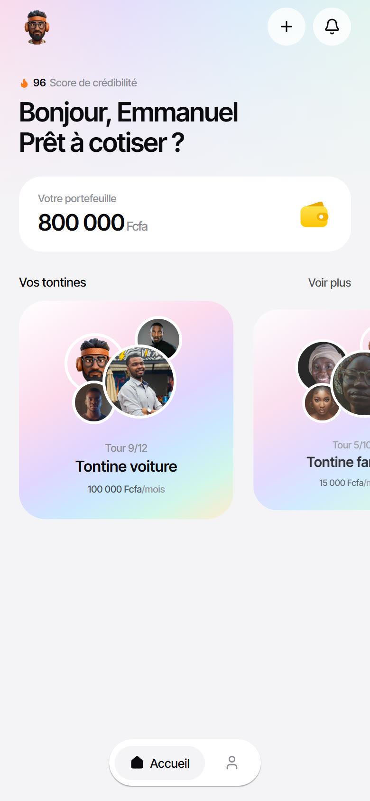
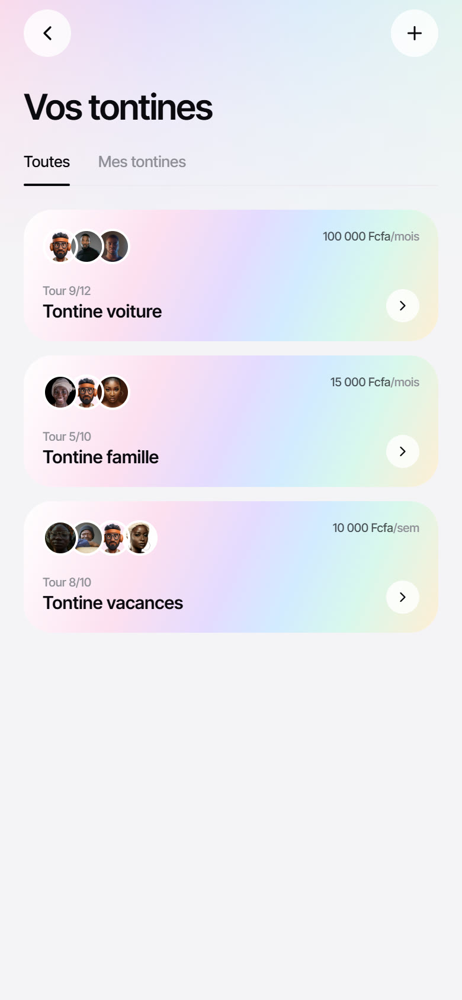
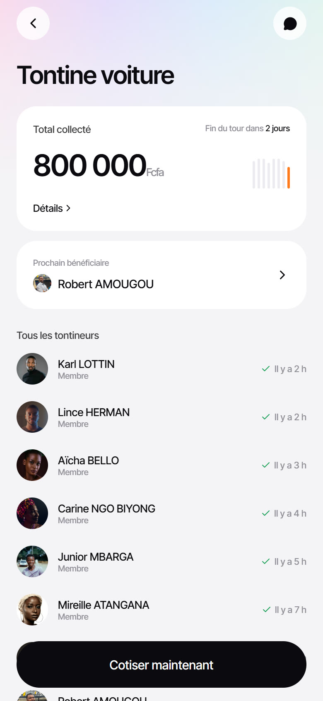
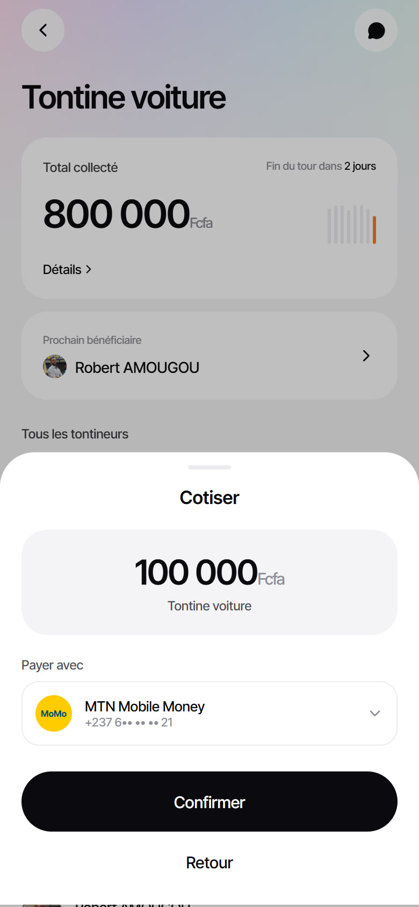
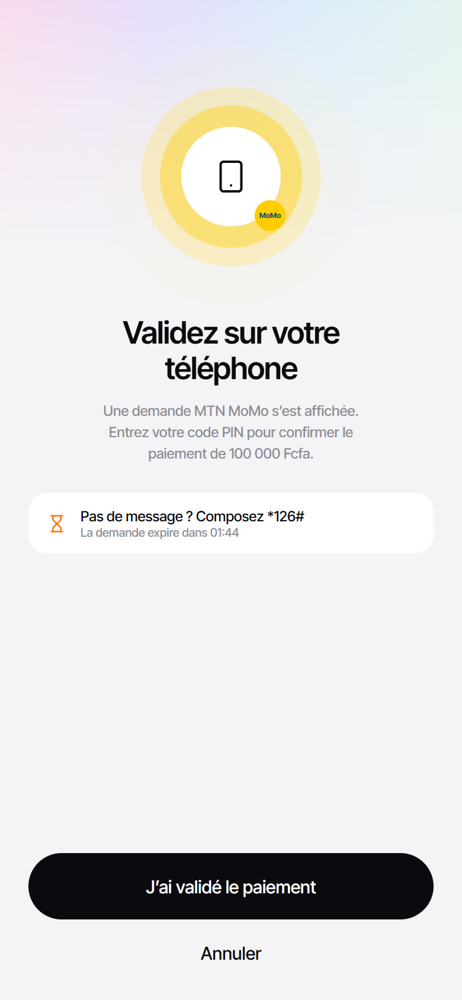
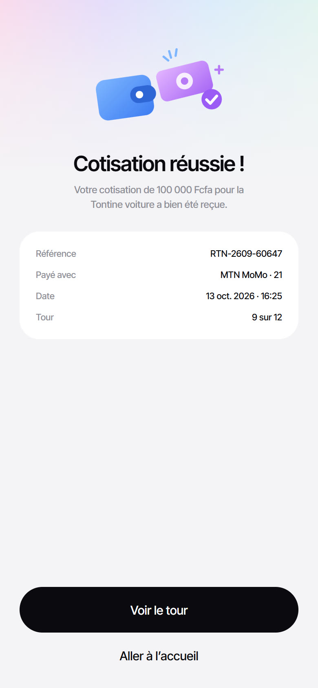
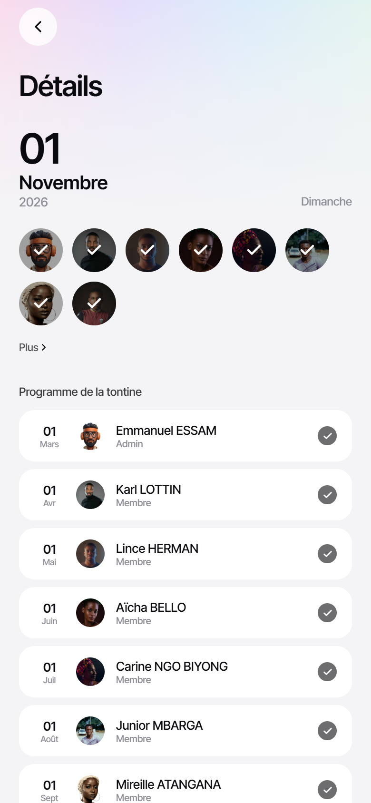
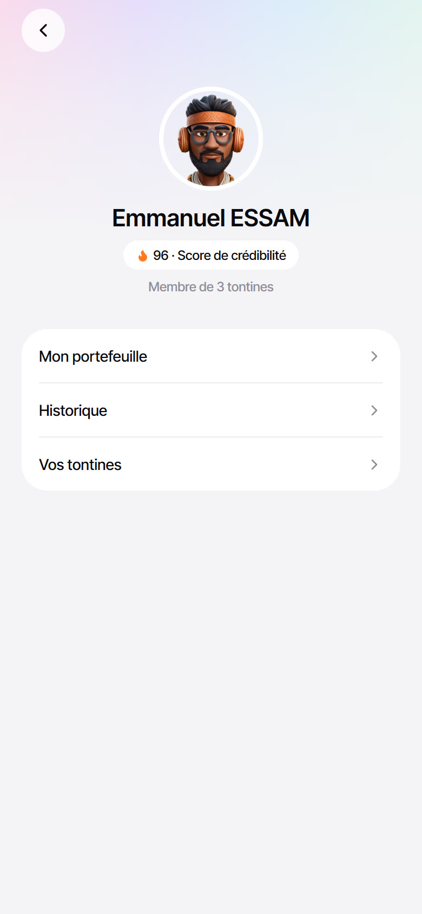
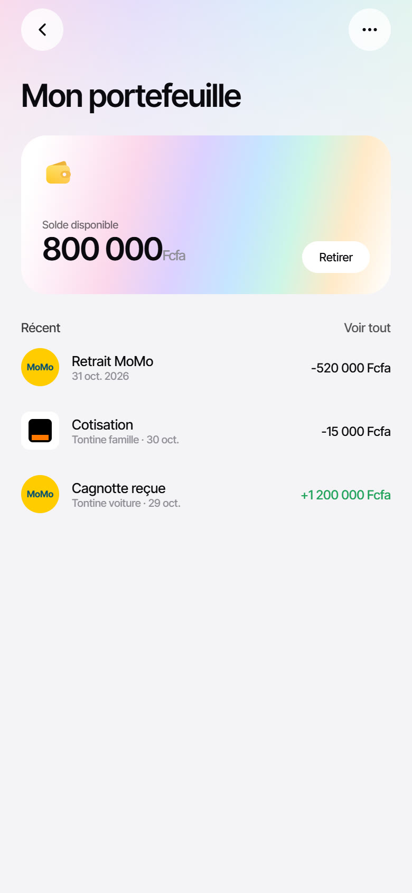
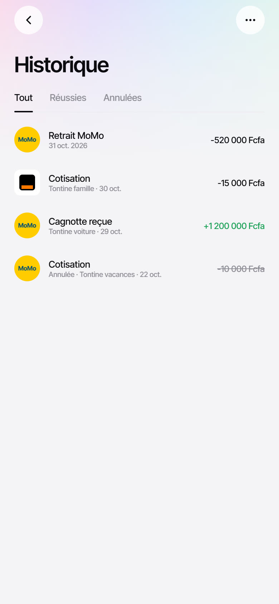

# Tontine

A mobile app for managing tontines (rotating savings groups) and paying contributions with Mobile Money. It is built with **Expo** and **NativeWind**.

> **Design credit:** the UI and motion design are by **[Emani.Ui (@EmaniUi)](https://x.com/EmaniUi)**. This project recreates two of their shots in code:
> - [Tout son argent de tontine, en un seul parcours](https://x.com/EmaniUi/status/2108890290748792838) (home, tontines, wallet, history)
> - [Voir qui a déjà cotisé, puis cotiser pour soi](https://x.com/EmaniUi/status/2108485196467097853) (tour details, MoMo payment)
>
> All credit for the visual design goes to them. Go follow their work.

## Screenshots

| Accueil | Vos tontines | Tontine voiture | Cotiser |
| :---: | :---: | :---: | :---: |
|  |  |  |  |

| Validation MoMo | Cotisation réussie | Détails du tour | Profil |
| :---: | :---: | :---: | :---: |
|  |  |  |  |

| Mon portefeuille | Historique |
| :---: | :---: |
|  |  |

## Features

- **Home:** credibility score, wallet balance that counts up, and a tontine carousel where the cards scale as you scroll.
- **Tontines:** a list with "Toutes" / "Mes tontines" filters and pastel gradient cards.
- **Tontine detail:** total collected, a mini chart of past rounds, the next beneficiary, and who has already paid.
- **Contribution flow:** a bottom sheet (MTN MoMo or Orange Money), then a "validate on your phone" screen with a pulsing halo, a USSD fallback and a countdown, then a receipt. The check mark then springs onto your own avatar in the tour details.
- **Wallet & history:** recent transactions, plus history filtered by Tout / Réussies / Annulées.
- Haptics on iOS and Android. The data is mock, kept in memory (`src/lib/store.tsx`), and paying really updates the balance, the totals and the history.

## Stack

- [Expo SDK 57](https://docs.expo.dev) and [Expo Router](https://docs.expo.dev/router/introduction) (routes in `src/app`)
- [NativeWind 4](https://www.nativewind.dev) with Tailwind CSS 3.4
- React Native Reanimated 4, expo-linear-gradient, react-native-svg, expo-image, expo-haptics
- Inter Tight (`@expo-google-fonts/inter-tight`) and lucide-react-native icons

## Run it

```bash
npm install
npx expo start
```

Then:

- **On your phone, no development build needed:** install [Expo Go](https://expo.dev/go) and scan the QR code. Every native module this app uses ships with Expo Go.
- **In the browser:** press `w`, or run `npx expo start --web`.
- **Simulators:** press `i` (iOS) or `a` (Android).

If your phone isn't on the same Wi-Fi as your computer, use `npx expo start --tunnel`.

## Project layout

```
src/
  app/            screens (Expo Router)
    index.tsx             Accueil
    tontines/index.tsx    Vos tontines
    tontines/[id]/        detail, tour, validate, success
    wallet.tsx  history.tsx  profile.tsx
  components/     UI kit (ui.tsx), cards, bottom sheet, SVG art
  lib/            mock data and the in-memory store
assets/avatars/   member portraits
```

## Credits

- **Design:** [Emani.Ui (@EmaniUi)](https://x.com/EmaniUi)
- **Member portraits:** [Unsplash](https://unsplash.com) photographers, used under the Unsplash License
